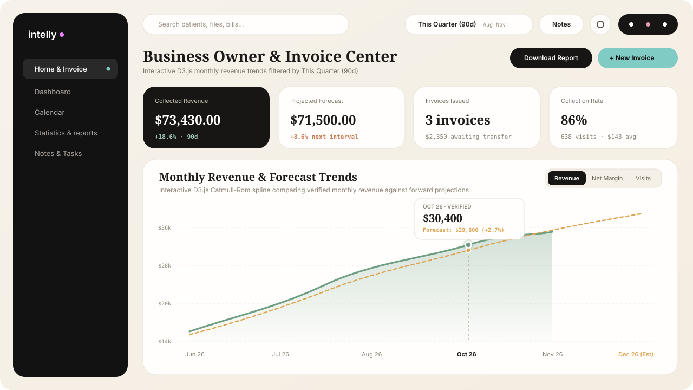
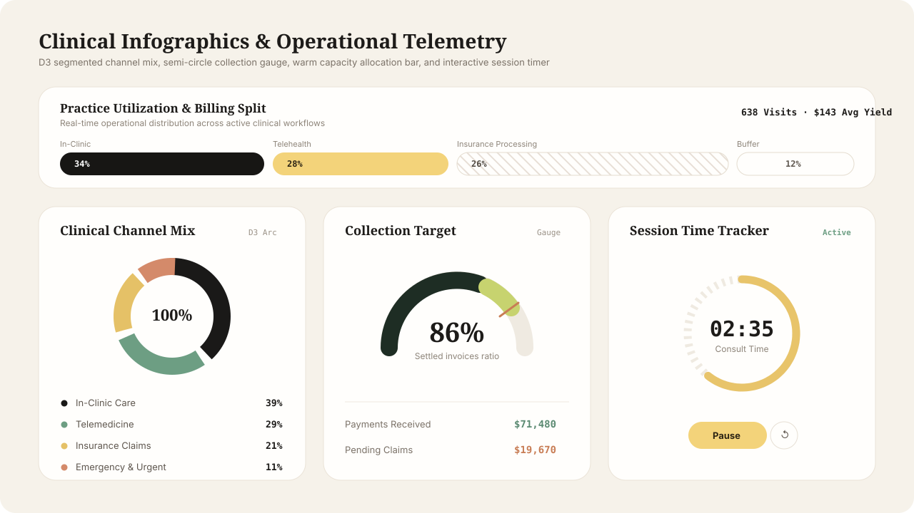
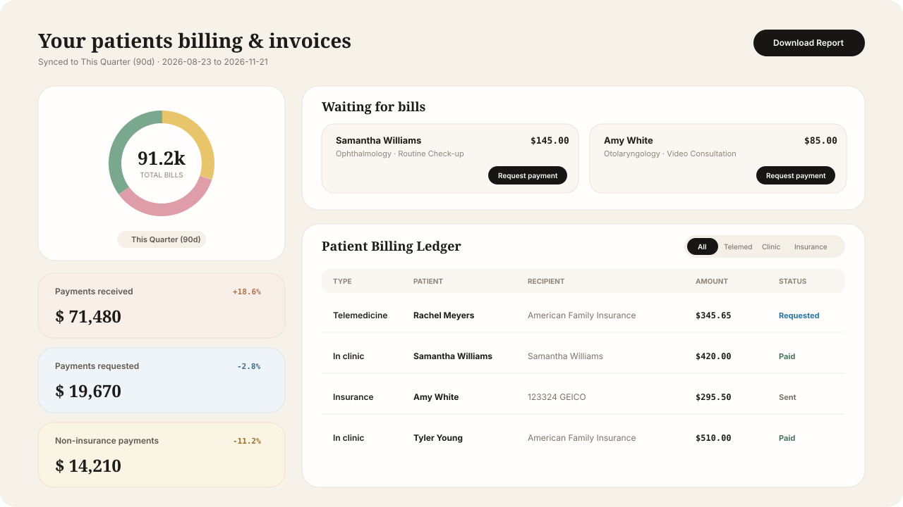
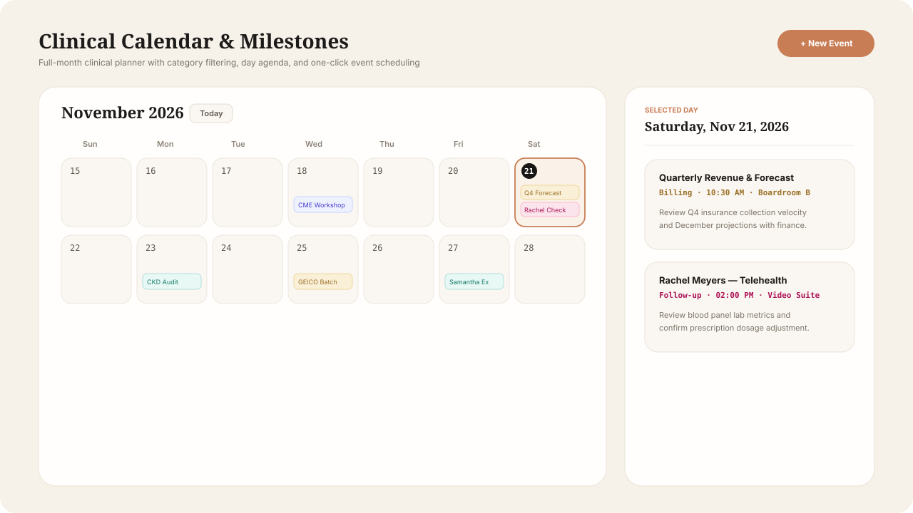
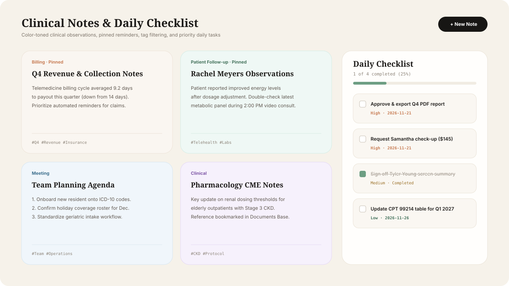
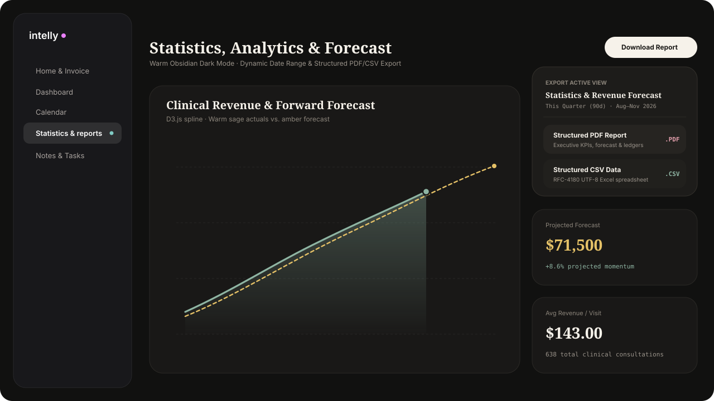
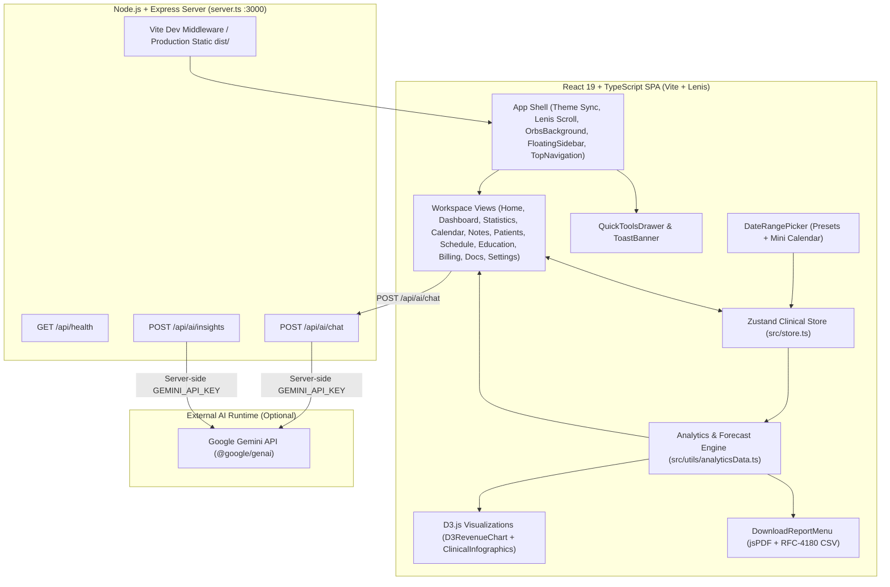
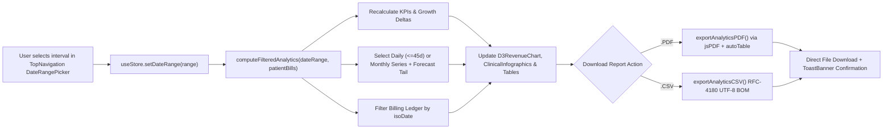

<div align="center">


<br />

<p>
  <strong>An editorial-grade clinical operations, executive invoicing, D3.js analytics, forecasting, and practice productivity platform built with React 19, TypeScript, Tailwind CSS v4, D3.js, Lenis, Express, and the Google Gemini SDK.</strong>
</p>

<p>
  
  
  
  
  
  
  
  
  
</p>

<p>
  <a href="#preview-gallery">Preview Gallery (7 Screens)</a> •
  <a href="#core-capabilities">Capabilities</a> •
  <a href="#system-architecture">Architecture</a> •
  <a href="#quick-start">Quick Start</a> •
  <a href="#documentation-hub">Documentation Hub</a> •
  <a href="#project-structure">Project Structure</a>
</p>

</div>

---

## Preview Gallery

Explore all 7 core surfaces of **Intelly Clinical Suite**, spanning warm pastel Light mode, interactive D3.js analytics, editorial clinical infographics, scheduling, notes, and warm obsidian Dark mode.

### 1. Business Owner & Invoice Center (Primary Portal)

<div align="center">
  
  <p><em>Screen 1 — Business Owner &amp; Invoice Center with floating collapsible navigation, live KPI metrics, administrative overview hub, and corporate invoice register.</em></p>
</div>

<br />

<table>
  <tr>
    <td width="50%" align="center" valign="top">
      
      <br />
      <strong>2. D3.js Monthly Revenue &amp; Forecast Analytics</strong>
      <br />
      <sub>Catmull-Rom spline line &amp; area chart with Revenue / Net Margin / Visits toggle, dashed forecast tail, and hover crosshair.</sub>
    </td>
    <td width="50%" align="center" valign="top">
      
      <br />
      <strong>3. Warm Pastel Editorial Infographics</strong>
      <br />
      <sub>Practice utilization striped bar, D3 segmented channel donut, D3 semi-circle collection gauge, and live session timer.</sub>
    </td>
  </tr>
  <tr>
    <td width="50%" align="center" valign="top">
      
      <br />
      <strong>4. Patients Billing &amp; Claims Queue</strong>
      <br />
      <sub>Interval-filtered received/requested KPIs, waiting-for-bills dispatch queue, settlements feed, and searchable claims register.</sub>
    </td>
    <td width="50%" align="center" valign="top">
      
      <br />
      <strong>5. Clinical Calendar &amp; Day Agenda</strong>
      <br />
      <sub>Full-month interactive calendar grid, category filters (Clinical, Billing, Follow-up, Personal), and day agenda panel.</sub>
    </td>
  </tr>
  <tr>
    <td width="50%" align="center" valign="top">
      
      <br />
      <strong>6. Clinical Notes &amp; Daily Checklist</strong>
      <br />
      <sub>Pastel paper-toned clinical notes with pinning and tags paired with a priority daily checklist and completion tracker.</sub>
    </td>
    <td width="50%" align="center" valign="top">
      
      <br />
      <strong>7. Warm Obsidian Dark Mode &amp; Report Export</strong>
      <br />
      <sub>One-click Light/Dark mode switching, dynamic DateRangePicker, and structured PDF (jsPDF) / CSV report exporter.</sub>
    </td>
  </tr>
</table>

---

## Overview

**Intelly Clinical Suite** unifies financial operations, patient billing, interactive D3.js revenue trends, forward forecasting, clinical scheduling, note-taking, medical education tracking, and AI-assisted advisory inside a single responsive workspace. Built around restrained editorial typography (`Playfair Display`, `Inter`, `Space Grotesk`, and `JetBrains Mono` with tabular numerals), the interface pairs a calm warm pastel surface system (`#F6F2EA` alabaster, `#FFFEFC` ivory, `#171614` obsidian anchor card, muted sage, butter, and terracotta accents) with **Light**, **Dark**, and **Galaxy** themes, **Lenis** smooth scrolling, and a collapsible sidebar with optional YouTube-style `0.5s` auto-hover expansion.

### Key Highlights

- **Interactive D3.js Monthly Revenue Line Chart**: Built natively with `d3` v7 (`scalePoint`, `scaleLinear`, `curveCatmullRom`), featuring `ResizeObserver` responsiveness, animated path reveal, Revenue / Net Margin / Visits switching, dashed forward forecast tails, and pointer crosshair tooltips synced to the active date interval.
- **Warm Pastel Editorial Infographics**: Includes a striped practice utilization capacity bar, a D3 segmented channel-mix donut (`d3.pie` + `d3.arc`), a D3 180-degree collection target gauge with live needle, and a working consultation session stopwatch.
- **Zero-Friction Executive Reporting**: Export the active analytical view and selected date range as a multi-section **structured PDF** (`jsPDF` + `jspdf-autotable`) or an Excel-ready **RFC-4180 CSV** file directly from the dashboard header.
- **Global Dynamic Date Range Filtering**: Choose quick presets (`Last 7 Days`, `Last 30 Days`, `This Quarter`, `Year to Date`, `All Time & Forecast`) or select custom dates via the inline mini-calendar inside `TopNavigation`.
- **Direct Light / Dark Mode & Smooth Scrolling**: Toggle Light and Dark themes with one click from the top header (plus Galaxy mode in Settings), while `Lenis` delivers fluid wheel scrolling that respects `prefers-reduced-motion` and preserves native nested scroll containers via `data-lenis-prevent`.
- **Resilient Server-Side Gemini Integration**: Express API routes proxy requests to `@google/genai` using server-side environment secrets and degrade gracefully to deterministic clinical fallbacks when `GEMINI_API_KEY` is omitted locally.

---

## Core Capabilities

| Module | Sidebar Route | Key Functionality |
| :--- | :--- | :--- |
| **Business Owner & Invoice Center** | `Home & Invoice` | Obsidian anchor KPI strip, `D3RevenueChart`, `ClinicalInfographics`, corporate invoice generator with itemized totals, receipt modal, status filters, Workspace Pulse, and Download Report menu. |
| **Patients Billing & Analytics** | `Dashboard` | Interval-synced D3 revenue overview, received/requested/non-insurance KPIs, waiting-for-bills dispatch queue, latest settlements, and searchable billing ledger. |
| **Statistics & Forecast** | `Statistics & reports` | `D3RevenueChart` paired with Recharts `ComposedChart` actuals-vs-forecast projections, consultation mix `BarChart`, and 4-KPI yield strip filtered by `DateRangePicker`. |
| **Clinical Calendar** | `Calendar` | Full-month interactive calendar grid, category filters (`Clinical`, `Billing`, `Follow-up`, `Personal`), selected-day agenda, completion tracking, and event creation modal. |
| **Day Scheduler** | `Day Schedule` | Hourly clinical timetable with consultation cards, room allocations, participant avatars, and one-click video consultation join states. |
| **Notes & Daily Checklist** | `Notes & Tasks` | Color-toned clinical notes (`Ivory`, `Sage`, `Blush`, `Sky`, `Lavender`), pinning, tags, live search, and a priority task manager with progress bar. |
| **Workspace Companion** | `Top Bar -> Notes` | Slide-over drawer providing quick note capture, task check-offs, and upcoming calendar preview without leaving the active dashboard view. |
| **Patients Ledger** | `Patients` | Searchable patient registry with demographics, blood type, diagnosis, insurance metadata, and new patient intake modal. |
| **Learning Plan** | `Education` | Medical continuing-education (CME) progression tracker with linked learning subjects, completion toggles, and upcoming webinars/tasks. |
| **Clinical AI Assistant** | `Chats & calls` | Conversational advisory interface backed by Express `/api/ai/chat` and `@google/genai` with offline clinical context fallback. |
| **Billing Configuration** | `Billing` | Editable CPT fee schedule (`CPT 99213`–`90834`), insurance coverage ratios, and automated dispatch toggles. |
| **Documents Base** | `Documents base` | Drag-and-drop and click-to-upload clinical templates vault with category filtering (`Consent Forms`, `HIPAA & Compliance`, `Clinical Protocols`). |
| **Display & Session Settings** | `Settings` | Light / Dark / Galaxy theme switcher, 5 accent color palettes, YouTube-style `0.5s` hover sidebar toggle, and clinical lock-screen sign-out. |

---

## System Architecture



### Dynamic Filtering, Visualization & Export Flow



---

## Technology Stack

| Layer | Technology | Rationale |
| :--- | :--- | :--- |
| **UI Framework** | React 19 + TypeScript 5.8 | Strict static typing across domain models, analytics pipelines, and modular workspace components. |
| **Data Visualization** | D3.js 7 + Recharts 3 | Custom D3.js Catmull-Rom line chart, segmented donut, and 180-degree collection gauge alongside Recharts bar/composed charts. |
| **Build & Dev Server** | Vite 6 + `tsx` + Express 4 | Unified port `3000` full-stack runtime mounting Vite middleware in dev and serving `dist/` + `dist/server.cjs` in production. |
| **Styling & Motion** | Tailwind CSS v4 + `motion` + `lenis` | Warm pastel editorial Light/Dark/Galaxy themes (`@custom-variant dark`), spring transitions, and reduced-motion-aware smooth scrolling. |
| **State Management** | Zustand 5 | Lightweight centralized state for navigation, themes, date intervals, invoices, calendar, notes, and tasks. |
| **Document Export** | `jsPDF` + `jspdf-autotable` | Client-side multi-section PDF generation with styled tables and pagination — no popups or external print service required. |
| **AI Integration** | `@google/genai` | Server-side Gemini SDK integration via Express proxy routes so API keys never leak to browser bundles. |
| **Iconography** | `lucide-react` | Consistent stroke-weight functional UI icons across navigation, tables, calendars, and modals. |

---

## Quick Start

### Prerequisites

- **Node.js** `v20+` (LTS recommended)
- **npm** `v10+`

### 1. Clone & Install Dependencies

```bash
git clone <your-repository-url>
cd intelly-clinical-suite
npm install
```

### 2. Configure Environment Variables

Copy the template environment file and optionally supply your Gemini API key:

```bash
cp .env.example .env
```

```env
# Optional: Enables live Gemini responses on /api/ai/chat and /api/ai/insights.
# If omitted, Express serves deterministic domain-aware fallback responses.
GEMINI_API_KEY="YOUR_GEMINI_API_KEY"

# Application URL (used for deployment metadata)
APP_URL="http://localhost:3000"
```

### 3. Run in Development

```bash
npm run dev
```

The unified Express + Vite development server starts on **`http://localhost:3000`**.

### 4. Available Scripts

| Command | Description |
| :--- | :--- |
| `npm run dev` | Starts `server.ts` via `tsx` with Vite middleware mounted on port `3000`. |
| `npm run lint` | Runs strict TypeScript type-checking (`tsc --noEmit`). |
| `npm run build` | Builds the Vite frontend bundle (`dist/`) and compiles the Express server (`dist/server.cjs`). |
| `npm run start` | Runs the production Node server (`node dist/server.cjs`). |
| `npm run clean` | Removes build artifacts (`dist/`). |

---

## Project Structure

```text
.
├── docs/
│   ├── assets/
│   │   └── banner.svg                        # Custom vector repository banner
│   ├── screenshots/
│   │   ├── 02-d3-revenue-analytics.svg       # Screen 2: D3.js revenue & forecast chart
│   │   ├── 03-clinical-infographics.svg      # Screen 3: Editorial D3 infographics & timer
│   │   ├── 04-patients-billing-dashboard.svg # Screen 4: Patients billing queue & ledger
│   │   ├── 05-clinical-calendar.svg          # Screen 5: Interactive clinical calendar
│   │   ├── 06-notes-and-tasks.svg            # Screen 6: Clinical notes & daily checklist
│   │   └── 07-dark-mode-and-export.svg       # Screen 7: Warm dark mode & PDF/CSV export
│   ├── ARCHITECTURE.md                       # Deep technical architecture & Mermaid diagrams
│   ├── API.md                                # Express REST endpoint contracts & examples
│   ├── DATA_MODEL.md                         # Domain interfaces, ER diagram & state flows
│   ├── DEPLOYMENT.md                         # Build pipeline, production server & troubleshooting
│   └── FEATURES.md                           # Complete module walkthrough & user journeys
├── public/
│   └── assets/aistudio/
│       └── Business-Owner-Dashboard-Google-AI-Studio_a634bf5c.png # Screen 1: Live app capture
├── src/
│   ├── components/
│   │   ├── CalendarWorkspace.tsx             # Full-month interactive clinical calendar & agenda
│   │   ├── ClinicalInfographics.tsx          # D3 donut, gauge, striped utilization & timer
│   │   ├── D3RevenueChart.tsx                # D3.js v7 interactive multi-series line/area chart
│   │   ├── DateRangePicker.tsx               # Dynamic TopNavigation date range & mini-calendar
│   │   ├── DownloadReportMenu.tsx            # PDF & CSV structured report export menu
│   │   ├── FloatingSidebar.tsx               # Collapsible & 0.5s hover-expand navigation rail
│   │   ├── LoginScreen.tsx                   # Clinical session lock/sign-in overlay
│   │   ├── MainDashboard.tsx                 # Core workspace views & warm pastel editorial UI
│   │   ├── NotesWorkspace.tsx                # Clinical notes board & priority daily checklist
│   │   ├── OrbsBackground.tsx                # Calm warm pastel / dark / galaxy radial backdrop
│   │   ├── QuickToolsDrawer.tsx              # Global slide-over companion (Notes, Tasks, Calendar)
│   │   ├── ToastBanner.tsx                   # Action confirmation toast system
│   │   └── TopNavigation.tsx                 # Search, DateRangePicker, Light/Dark switch & profile
│   ├── utils/
│   │   ├── analyticsData.ts                  # Date-range filtering & forward forecast engine
│   │   └── reportExporter.ts                 # Structured PDF (jsPDF) & CSV file generator
│   ├── App.tsx                               # Root shell, theme class sync & Lenis smooth scroll
│   ├── index.css                             # Typography, Tailwind v4 dark variant & warm stripes
│   ├── main.tsx                              # React 19 DOM entry point
│   ├── store.ts                              # Centralized Zustand state store & actions
│   └── types.ts                              # Shared TypeScript interfaces
├── server.ts                                 # Express backend + Vite middleware + Gemini proxy
├── package.json                              # Dependencies & lifecycle scripts
├── metadata.json                             # App manifest metadata
├── CHANGELOG.md                              # Versioned release notes
├── CONTRIBUTING.md                           # Development workflow & coding guidelines
├── SECURITY.md                               # Security model & secret handling guidelines
└── .env.example                              # Safe environment variable template
```

---

## Documentation Hub

Explore the dedicated micro-documentation files for deeper technical reference:

| Document | Audience | Contents |
| :--- | :--- | :--- |
| [**docs/ARCHITECTURE.md**](./docs/ARCHITECTURE.md) | Engineers & Architects | Full-stack topology, D3.js & Lenis integration, Zustand slice map, sidebar hover state machine, and theme system. |
| [**docs/FEATURES.md**](./docs/FEATURES.md) | Product & Designers | Detailed breakdown of all 13 workspaces, interaction patterns, export workflows, and end-to-end user journeys. |
| [**docs/DATA_MODEL.md**](./docs/DATA_MODEL.md) | Engineers | Entity-Relationship Mermaid diagram, TypeScript contracts, analytics calculation schemas, and state transitions. |
| [**docs/API.md**](./docs/API.md) | Backend & Integrators | Express endpoint documentation (`/api/health`, `/api/ai/insights`, `/api/ai/chat`), payloads, and fallback modes. |
| [**docs/DEPLOYMENT.md**](./docs/DEPLOYMENT.md) | DevOps & Maintainers | Production bundling (`vite` + `esbuild`), Cloud Run / Node deployment checklist, env vars, and troubleshooting. |
| [**CONTRIBUTING.md**](./CONTRIBUTING.md) | Contributors | Local workflow, branching conventions, TypeScript/Tailwind standards, and pre-PR verification steps. |
| [**CHANGELOG.md**](./CHANGELOG.md) | All Stakeholders | Chronological record of features, visual upgrades, and architectural updates. |
| [**SECURITY.md**](./SECURITY.md) | Security Reviewers | Secret isolation, client-side export privacy, dependency hygiene, and disclosure guidance. |

---

## Verification & Quality Baseline

Before committing changes, run both static verification commands:

```bash
npm run lint   # TypeScript strict check (tsc --noEmit)
npm run build  # Full Vite client build + esbuild server bundle
```

---

## License

Licensed under the **Apache License 2.0**. See license headers across source modules for details.
