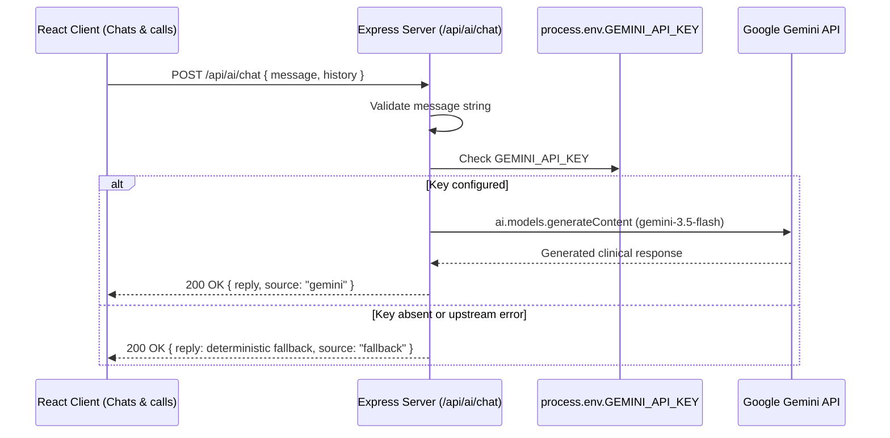

# API Reference

The Express backend (`server.ts`) exposes lightweight REST endpoints under `/api/*` on port `3000`. All AI requests are proxied server-side so `GEMINI_API_KEY` never leaves the server environment.

---

## Base URL

- **Development**: `http://localhost:3000`
- **Production**: Configured via `APP_URL` / reverse proxy host

All request and response bodies use `application/json`.

---

## Endpoints

### 1. Health Check

`GET /api/health`

Verifies server liveness and reports whether a server-side Gemini API key is configured.

#### Response `200 OK`

```json
{
  "status": "ok",
  "service": "intelly-clinical-suite",
  "aiConfigured": true,
  "timestamp": "2026-07-15T10:30:00.000Z"
}
```

---

### 2. Clinical & Financial Insights

`POST /api/ai/insights`

Generates concise executive commentary on revenue performance, pending claims, or operational trends based on supplied dashboard metrics.

#### Request Body

```json
{
  "context": {
    "totalRevenue": 48250,
    "outstandingReceivables": 6234,
    "collectionRate": 84,
    "dateRange": "Last 30 Days"
  }
}
```

#### Response `200 OK`

```json
{
  "insights": [
    "Collection efficiency reached 84% over the Last 30 Days; follow up on outstanding receivables to reclaim $6,234.",
    "Telemedicine consultations show strong margin stability compared to standard in-clinic follow-ups."
  ],
  "source": "gemini"
}
```

> **Fallback Behavior**: If `GEMINI_API_KEY` is not set or the upstream Gemini API is unreachable, the server returns `200 OK` with deterministic, metric-grounded clinical insights and `"source": "fallback"` so the UI never crashes during offline local development.

---

### 3. Clinical AI Assistant Chat

`POST /api/ai/chat`

Powers the conversational assistant inside the `Chats & calls` workspace using `@google/genai` (`gemini-3.5-flash`).

#### Request Body

```json
{
  "message": "Summarize how to reduce overdue insurance billing cycles.",
  "history": [
    {
      "role": "user",
      "text": "What CPT codes are highest volume this month?"
    },
    {
      "role": "model",
      "text": "CPT 99213 and CPT 99214 represent the majority of outpatient follow-up claims."
    }
  ]
}
```

#### Validation Rules
- `message` must be a non-empty string (`400 Bad Request` returned if missing or blank).
- `history` is optional and defaults to an empty array.

#### Response `200 OK`

```json
{
  "reply": "Verify payer eligibility 48 hours prior to scheduled consultations, submit clean CPT-coded claims within 24 hours of encounter sign-off, and review waiting-for-bills queues daily.",
  "source": "gemini"
}
```

#### Error Responses

| Status Code | Condition | Payload |
| :--- | :--- | :--- |
| `400 Bad Request` | Missing or empty `message` field | `{ "error": "Message is required." }` |
| `500 Internal Server Error` | Unhandled server exception | `{ "error": "Internal server error." }` |

---

## Request Flow Sequence


