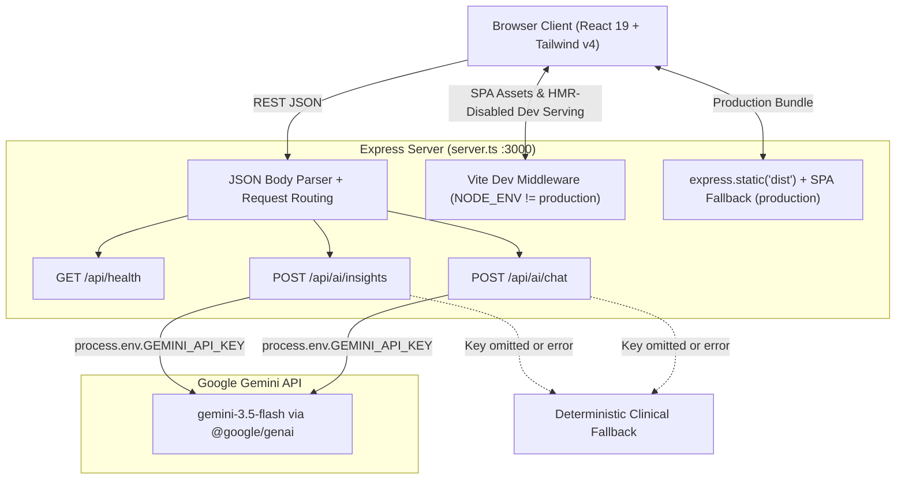
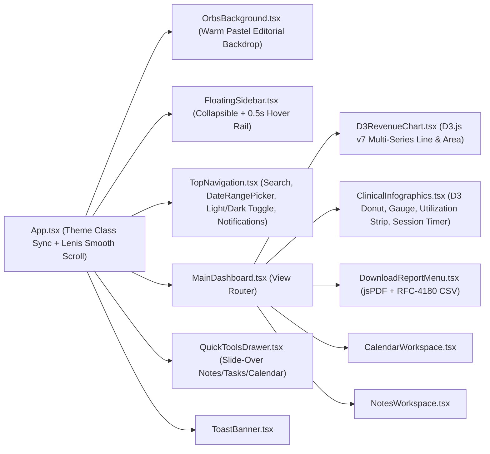
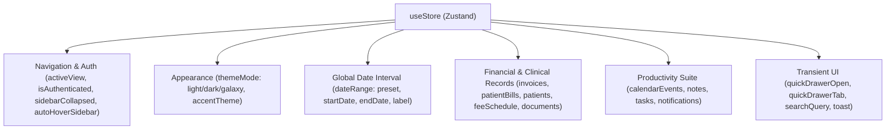
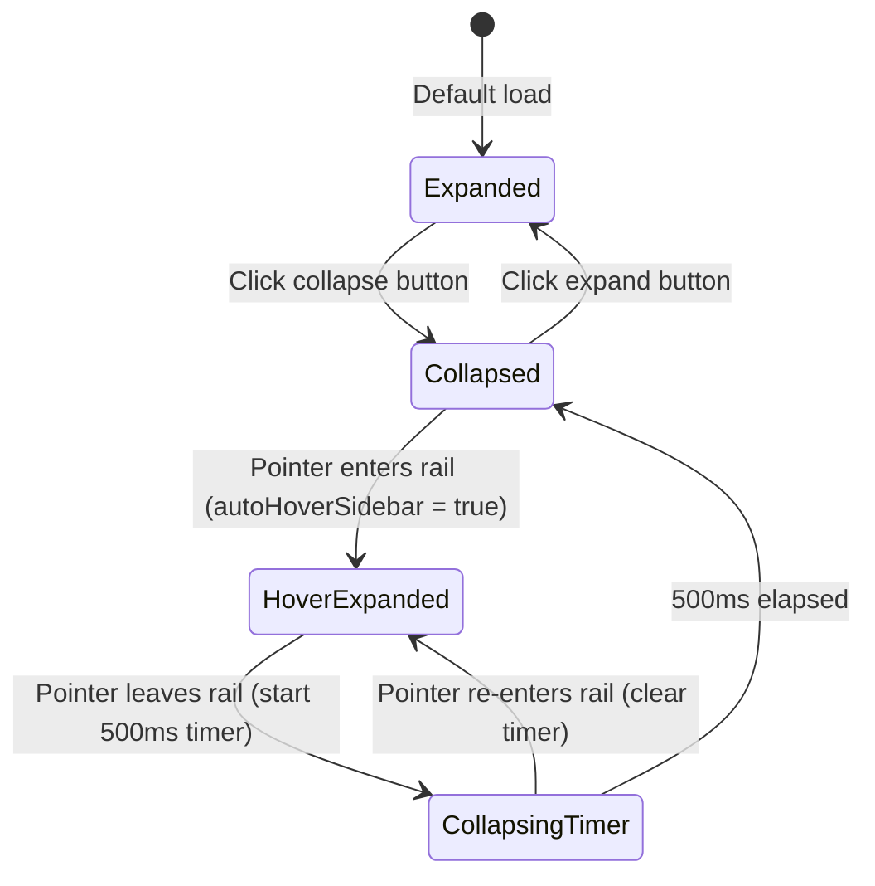

# Architecture Reference

This document details the technical architecture, rendering topology, data visualization pipeline, state management slices, theme synchronization, and motion/scrolling systems behind **Intelly Clinical Suite**.

---

## 1. Full-Stack Runtime Topology

The application operates as a unified Node.js + Express server (`server.ts`) on port `3000`. In development (`npm run dev`), Express mounts Vite's middleware to serve the React 19 + TypeScript SPA directly alongside API routes. In production (`npm run build && npm run start`), Express serves the pre-compiled static bundle from `dist/` and handles `/api/*` requests from `dist/server.cjs`.

---

## 2. Frontend Module Composition

### Core Responsibilities

| Module | Path | Primary Responsibility |
| :--- | :--- | :--- |
| **Root Shell** | `src/App.tsx` | Synchronizes `themeMode` to `<html class="dark">`, initializes `Lenis` smooth scrolling with `prefers-reduced-motion` guard, and composes global layout chrome. |
| **Editorial Backdrop** | `src/components/OrbsBackground.tsx` | Renders calm, low-distraction warm pastel radial washes tuned to Light (`#F6F2EA`), Dark (`#111110`), and Galaxy (`#0B0A18`) modes. |
| **Navigation Rail** | `src/components/FloatingSidebar.tsx` | Manages manual collapse toggle and optional YouTube-style auto-expand on hover with a `0.5s` collapse delay. |
| **Top Bar** | `src/components/TopNavigation.tsx` | Houses global search, `DateRangePicker`, 1-click Light/Dark mode toggle, notification popover (`data-lenis-prevent`), and Companion Drawer button. |
| **D3 Revenue Analytics** | `src/components/D3RevenueChart.tsx` | Interactive D3.js v7 chart rendering monthly/daily revenue actuals, net margin, and consultation volume with dashed forward forecast tails. |
| **Editorial Infographics** | `src/components/ClinicalInfographics.tsx` | Combines a warm striped utilization bar, D3 segmented donut (`d3.pie` + `d3.arc`), D3 semi-circle collection gauge with animated needle, and an interactive consultation timer. |
| **Analytics Engine** | `src/utils/analyticsData.ts` | Deterministic interval filtering, daily-vs-monthly granularity selection, KPI delta calculation, and forecast series synthesis. |
| **Export Pipeline** | `src/utils/reportExporter.ts` | Generates multi-section structured PDF documents (`jsPDF` + `jspdf-autotable`) and UTF-8 BOM CSV exports directly in the browser. |

---

## 3. Data Visualization Architecture

### D3.js Monthly Revenue Chart (`D3RevenueChart.tsx`)

The primary analytical chart is built directly on **D3.js v7** rather than a black-box wrapper, providing deterministic SVG layout and smooth interactive inspection:

1. **Responsive Geometry**: A `ResizeObserver` tracks container width and recomputes `d3.scalePoint` (X-axis time labels) and `d3.scaleLinear` (Y-axis currency or volume) cleanly on viewport resize.
2. **Smooth Curves & Dual Series**: Uses `d3.curveCatmullRom.alpha(0.5)` to draw a filled warm sage area gradient, a crisp solid actuals stroke, and a dashed terracotta forward-forecast segment seamlessly bridging from the last verified actual point.
3. **Metric Switching**: Supports toggling between **Revenue ($)**, **Net Margin ($)**, and **Patient Visits** without leaving the active dashboard view.
4. **Animated Reveal**: Computes exact SVG path lengths via `getTotalLength()` and animates `stroke-dashoffset` on data/interval changes (automatically skipped when `prefers-reduced-motion: reduce` is enabled).
5. **Pointer Crosshair**: An invisible pointer capture overlay maps cursor X coordinates to the nearest datum, positioning a vertical crosshair line, haloed focus marker, and floating tooltip popover.

### Editorial Infographic Widgets (`ClinicalInfographics.tsx`)

- **D3 Channel Mix Donut**: Computes segmented ring arcs via `d3.pie().padAngle(0.04)` and `d3.arc().cornerRadius(6)` across Telemedicine, In-Clinic, and Insurance billing streams with interactive hover highlighting.
- **D3 Collection Target Gauge**: Renders a 180-degree semi-circular progress gauge with tick marks and a computed vector needle tracking live collected-to-billed percentage.
- **Utilization Capacity Strip**: Uses CSS diagonal warm stripes (`.warm-stripes`) to compare cleared collections, pending receivables, and remaining practice capacity.
- **Interactive Consultation Session Timer**: Stateful `setInterval` stopwatch (`Start`, `Pause`, `Reset`) with tabular monospace numerals (`tabular-nums`).

---

## 4. State Management (`src/store.ts`)

All frontend state lives in a single typed **Zustand** store (`useStore`) organized into logical slices:

---

## 5. Sidebar Hover State Machine (`FloatingSidebar.tsx`)

When `autoHoverSidebar` is enabled in Settings and the user has manually collapsed the rail (`sidebarCollapsed: true`), hovering over the collapsed rail expands it immediately. Moving the pointer away schedules a `500ms` (`0.5s`) debounce timer before collapsing back, preventing accidental flicker while navigating between menu items.

---

## 6. Styling, Typography & Smooth Scrolling

- **Typography**: `Playfair Display` (editorial headers), `Inter` (body copy), `Space Grotesk` (compact controls/labels), and `JetBrains Mono` (invoice IDs, CPT codes, currency figures with `font-variant-numeric: tabular-nums`).
- **Warm Pastel Editorial Palette**:
  - Light Surface: `#F6F2EA` (warm alabaster canvas), `#FFFEFC` (elevated ivory cards), `#171614` (obsidian anchor KPI card).
  - Semantic Pastels: `#6D9E83` (muted sage), `#E8C46A` (warm butter), `#C87D55` (terracotta), `#8A79A8` (soft plum).
  - Dark Surface: `#111110` canvas with `#1A1918` elevated cards activated via Tailwind v4 `@custom-variant dark (&:where(.dark, .dark *));`.
- **Lenis Smooth Scrolling**: Initialized inside `App.tsx` using a dedicated `requestAnimationFrame` loop (`lerp: 0.1`, `wheelMultiplier: 0.95`). Scrollable popovers and drawers declare `data-lenis-prevent` to preserve native nested scrolling, and Lenis automatically disables itself when the OS prefers reduced motion.
