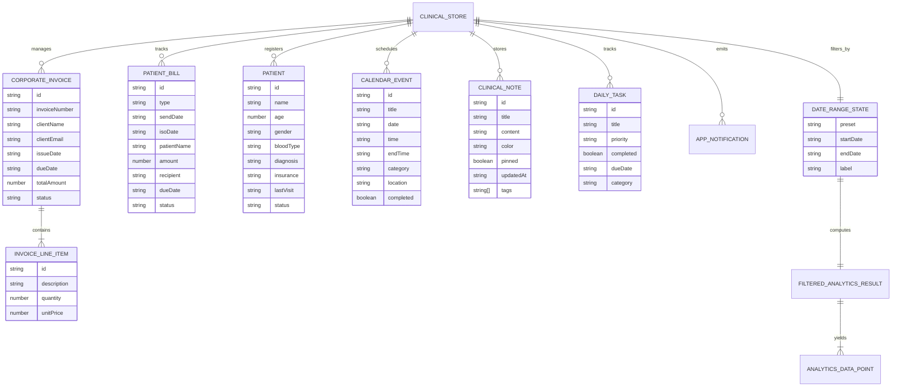
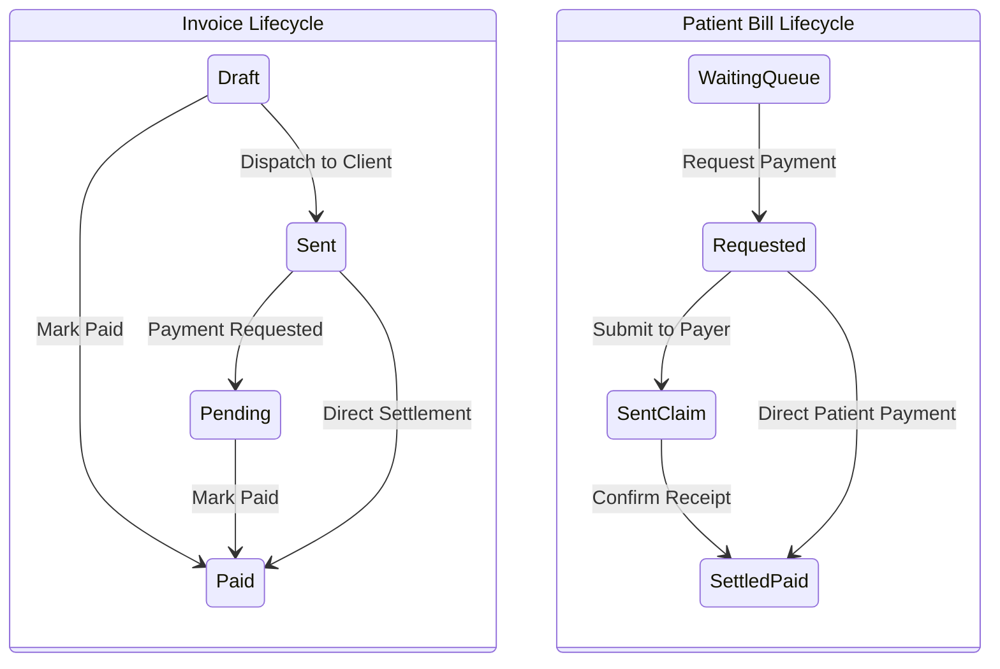

# Data Model & State Contracts

All domain entities and analytical payloads are strictly typed in `src/types.ts` and `src/utils/analyticsData.ts`, and managed through the centralized Zustand store in `src/store.ts`.

---

## 1. Entity-Relationship Overview



---

## 2. Core TypeScript Interfaces (`src/types.ts`)

### Navigation & Theme Contracts

| Type | Allowed Values | Purpose |
| :--- | :--- | :--- |
| `ActiveView` | `'home' \| 'dashboard' \| 'schedule' \| 'calendar' \| 'notes' \| 'patients' \| 'statistics' \| 'education' \| 'chats' \| 'billing' \| 'documents' \| 'settings'` | Active primary workspace rendered inside `MainDashboard`. |
| `ThemeMode` | `'light' \| 'dark' \| 'galaxy'` | Global visual palette synchronized with `<html class="dark">` and `OrbsBackground`. |
| `AccentTheme` | `'emerald' \| 'indigo' \| 'rose' \| 'amber' \| 'cyan'` | Highlight color system configurable from Settings. |
| `DateRangePreset` | `'7d' \| '30d' \| '90d' \| 'ytd' \| 'all' \| 'custom'` | Preset identifier controlling `DateRangePicker` and interval calculation. |

### Productivity & Notification Contracts

- **`CalendarEvent`**: Anchored by ISO date (`YYYY-MM-DD`), start/end time strings, category (`'clinical' | 'billing' | 'followup' | 'personal'`), optional room/location, notes, and `completed` boolean.
- **`ClinicalNote`**: Supports 5 warm paper tones (`'ivory' | 'sage' | 'blush' | 'sky' | 'lavender'`), `pinned` flag for sorting priority, ISO timestamp (`updatedAt`), and keyword `tags`.
- **`DailyTask`**: Tracks `priority` (`'high' | 'medium' | 'low'`), completion toggle, optional due date, and operational category.
- **`AppNotification`**: Represents unread/read clinical alerts displayed in `TopNavigation` popover with type classification (`'payment' | 'schedule' | 'system' | 'note'`).
- **`ToastItem`**: Ephemeral notification banner (`message`, `tone: 'success' | 'info' | 'warning'`) auto-dismissed after 3.2 seconds.

---

## 3. Analytics & Forecast Contract (`src/utils/analyticsData.ts`)

`computeFilteredAnalytics(dateRange, patientBills)` produces a deterministic `FilteredAnalyticsResult` consumed identically by `D3RevenueChart`, `ClinicalInfographics`, `MainDashboard` KPI cards, and `reportExporter`:

```ts
export interface AnalyticsDataPoint {
  label: string;          // e.g., "May 2026" or "Jul 14"
  isoDate: string;        // Canonical YYYY-MM-DD key
  revenue: number;        // Verified actual revenue ($)
  forecast?: number;      // Forward projection ($)
  profit: number;         // Net margin ($)
  visits: number;         // Completed consultations
  telemedicine: number;   // Telehealth visit count
  inClinic: number;       // In-person visit count
  insurance: number;      // Insurance-billed visit count
  isForecast?: boolean;   // Distinguishes future dashed segment
}

export interface FilteredAnalyticsResult {
  points: AnalyticsDataPoint[];
  filteredBills: PatientBill[];
  kpis: {
    totalRevenue: number;
    projectedRevenue: number;
    netProfit: number;
    profitMarginPct: number;
    totalVisits: number;
    avgRevenuePerVisit: number;
    growthPct: number;
    receivedAmount: number;
    requestedAmount: number;
    nonInsuranceAmount: number;
  };
  granularity: 'daily' | 'monthly';
}
```

### Granularity Switching Rules
- When the selected `dateRange` spans **45 days or fewer**, the engine outputs **daily granularity** points and appends a short-term forecast tail.
- When the span exceeds **45 days** (`This Quarter`, `Year to Date`, `All Time & Forecast`, or multi-month custom ranges), the engine aggregates to **monthly granularity** and appends a multi-month forward forecast series so `D3RevenueChart` and `ComposedChart` remain legible without label collisions.

---

## 4. State Transition Lifecycle


