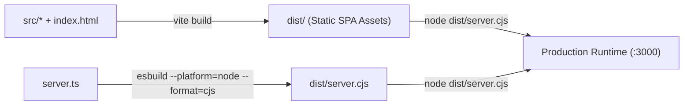

# Deployment & Operations Guide

This guide covers building, running, configuring, and troubleshooting **Intelly Clinical Suite** in local development and production environments.

---

## 1. Build Pipeline Architecture

`npm run build` executes two sequential steps defined in `package.json`:

1. **Client Bundle (`vite build`)**: Compiles React 19, TypeScript, Tailwind CSS v4, D3.js, Recharts, jsPDF, and Lenis into optimized static assets under `dist/`.
2. **Server Bundle (`esbuild server.ts`)**: Bundles `server.ts` into a CommonJS Node entry point at `dist/server.cjs` with externalized `node_modules` and source maps enabled.



---

## 2. Environment Variables

Configure runtime variables in `.env` (local) or your hosting provider's secret manager (production). Reference `.env.example` for the canonical keys:

| Variable | Required | Default | Description |
| :--- | :--- | :--- | :--- |
| `GEMINI_API_KEY` | Optional | Unset | Server-side Google Gemini API key for `/api/ai/chat` and `/api/ai/insights`. When omitted, deterministic clinical fallbacks are served. |
| `APP_URL` | Optional | `http://localhost:3000` | Public canonical URL of the deployed instance. |
| `NODE_ENV` | Production | `development` | Set to `production` so `server.ts` serves static assets from `dist/` instead of mounting Vite dev middleware. |
| `PORT` | Optional | `3000` | Listening TCP port (defaults to `3000`). |

> **Security Note**: Never prefix server secrets with `VITE_`. Vite embeds `VITE_*` variables into client JavaScript bundles.

---

## 3. Production Build & Startup Verification

Run the following commands to verify a clean production release:

```bash
# 1. Install dependencies cleanly
npm ci

# 2. Run strict TypeScript type checks
npm run lint

# 3. Compile client SPA and Express server bundle
npm run build

# 4. Launch production server
NODE_ENV=production npm run start
```

Verify liveness against the running server:

```bash
curl http://localhost:3000/api/health
```

Expected response:

```json
{
  "status": "ok",
  "service": "intelly-clinical-suite",
  "aiConfigured": false,
  "timestamp": "..."
}
```

---

## 4. Container & Cloud Run Deployment Checklist

When deploying to Google Cloud Run, Fly.io, Render, or a Docker container:

- **Exposed Port**: Configure container port `3000` (or bind `PORT` environment variable).
- **Build Command**: `npm ci && npm run build`
- **Start Command**: `NODE_ENV=production npm run start`
- **Health Probe**: Point HTTP readiness and liveness checks to `GET /api/health`.
- **Secrets**: Mount `GEMINI_API_KEY` via Cloud Secret Manager or platform secret environment variables rather than baking `.env` into container layers.
- **Static Caching**: Serve `/assets/*` with long-lived immutable cache headers behind your CDN/load balancer while keeping `index.html` revalidated.

---

## 5. Troubleshooting

| Symptom | Likely Cause | Resolution |
| :--- | :--- | :--- |
| `vite: not found` or `tsx: not found` | Dependencies not installed | Run `npm install` and retry `npm run dev`. |
| Port `3000` already in use | Another dev server process is active | Stop the conflicting process or restart the runtime container. |
| AI chat returns fallback messages | `GEMINI_API_KEY` missing or invalid | Set a valid `GEMINI_API_KEY` in `.env` (or secret manager) and restart the server. |
| Dark mode classes not updating | Missing `.dark` class on `<html>` | Verify `App.tsx` theme effect is active and Tailwind `@custom-variant dark` exists in `src/index.css`. |
| Nested dropdowns fail to scroll smoothly | Lenis intercepting wheel events | Ensure scrollable overlays include the `data-lenis-prevent` attribute. |
| PDF export fails to download | Browser blocked automatic download | Check browser download permissions; `reportExporter.ts` triggers direct Blob downloads without popups. |
