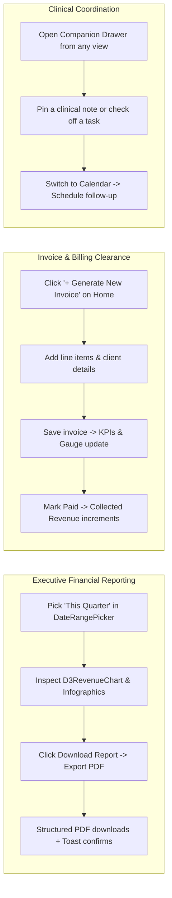

# Features & Module Walkthrough

**Intelly Clinical Suite** organizes clinical administration, financial reporting, patient scheduling, and team productivity into 13 focused workspaces plus global navigation utilities.

---

## 1. Global Chrome & Cross-Cutting Utilities

### Dynamic Date Range Picker (`TopNavigation -> DateRangePicker`)
- **Quick Presets**: `Last 7 Days`, `Last 30 Days`, `This Quarter`, `Year to Date`, and `All Time & Forecast`.
- **Custom Range Mini-Calendar**: Interactive month calendar inside the dropdown allowing two-click selection of arbitrary start and end ISO dates.
- **Reactive Scope**: Updating the date range immediately recalculates KPIs, `D3RevenueChart` data points, forward forecast horizons, `ClinicalInfographics` ratios, and filtered billing tables across Home, Dashboard, and Statistics views.

### Structured Report Exporter (`DownloadReportMenu`)
- **Structured PDF (`.pdf`)**: Generates an editorial multi-page report using `jsPDF` and `jspdf-autotable` containing the active view title, selected date interval, executive KPI grid, time-series revenue & forecast table, and itemized billing/invoice ledger.
- **Spreadsheet CSV (`.csv`)**: Exports an RFC-4180 compliant, UTF-8 BOM encoded CSV file ready to open directly in Excel, Google Sheets, or Numbers.
- **Non-blocking Feedback**: Triggers direct browser download and displays a confirmation toast via `ToastBanner` without popup windows.

### One-Click Light / Dark Mode Switch & Theme Engine
- **Header Switcher**: Dedicated Sun/Moon button in `TopNavigation` toggles immediately between warm pastel **Light** mode (`#F6F2EA`) and warm obsidian **Dark** mode (`#111110`).
- **Galaxy Theme & Accent Palettes**: Accessible under `Settings` for deep cosmic night surfaces and 5 coordinated accent color sets.

### Workspace Companion Drawer (`TopNavigation -> Notes`)
- Slide-over panel accessible from any route with three tabs:
  1. **Quick Notes**: Create, pin, and filter short clinical memos without leaving financial reports.
  2. **Daily Tasks**: Add priority checklist items and mark them complete with instant progress updates.
  3. **Upcoming Events**: Inspect upcoming appointments and jump directly into the full Clinical Calendar.

---

## 2. Core Workspace Modules

### Business Owner & Invoice Center (`Home & Invoice`)
- **Obsidian Anchor KPI Row**: Highlights Collected Revenue on a high-contrast `#171614` anchor card paired with 3 warm ivory cards (Outstanding Receivables, Invoices Issued, Collection Efficiency).
- **D3.js Monthly Revenue Trend**: Interactive spline line & area chart with Revenue / Net Margin / Visits toggle and forward forecast curve.
- **Editorial Clinical Infographics**: Practice Utilization & Billing Split bar, D3 Channel Mix Donut, D3 Collection Target Gauge, and interactive Consultation Session Timer.
- **Corporate Invoice Generator**: Create multi-line itemized invoices with automatic subtotal/tax calculation, status transitions (`Draft`, `Sent`, `Pending`, `Paid`), receipt preview modal, and deletion.
- **Workspace Pulse Strip**: Summarizes upcoming calendar milestones and pinned clinical notes alongside quick navigation links.

### Patients Billing & Analytics (`Dashboard`)
- **Billing Breakdown & KPIs**: Interval-filtered received payments, requested claims, and non-insurance totals.
- **D3 Revenue Overview**: Synced directly to the active date interval with direct PDF/CSV report export.
- **Waiting for Bills Queue**: One-click payment dispatch queue moving pending patient encounters into active billing status.
- **Searchable Claims Ledger**: Filter by channel (`All`, `Telemedicine`, `In-clinic`, `Insurance`), mark settlements paid, or inspect claim details.

### Statistics & Forecast (`Statistics & reports`)
- **Verified Actuals vs. Forward Forecast**: Dual-view analytics combining the interactive `D3RevenueChart` with Recharts `ComposedChart` and `BarChart` consultation mix breakdowns.
- **Yield Metrics**: Average revenue per patient, net profit margin, visit count, and period-over-period growth deltas computed dynamically by `computeFilteredAnalytics`.

### Clinical Calendar (`Calendar`)
- **Full-Month Interactive Grid**: Navigate across months, highlight days containing scheduled events, and jump back to Today.
- **Category Filtering**: Filter events across `All`, `Clinical`, `Billing`, `Follow-up`, and `Personal`.
- **Selected-Day Agenda**: View time slots, location/room metadata, completion checkboxes, deletion controls, and an **Add Event** modal.

### Day Schedule (`Day Schedule`)
- Hourly clinical timetable showing room assignments, visit categories, participating clinicians, and telemedicine join actions.

### Notes & Tasks Workspace (`Notes & Tasks`)
- **Clinical Notes Board**: Filter by search query or pinned state, assign pastel paper tones (`Ivory`, `Sage`, `Blush`, `Sky`, `Lavender`), add comma-separated tags, edit or delete entries.
- **Daily Checklist**: Manage `High`, `Medium`, and `Low` priority tasks with completion progress bar and category labels.

### Patients Ledger (`Patients`)
- Searchable patient registry displaying demographics, blood type, primary diagnosis, insurance carrier, and a modal for registering new patients.

### Medical Learning Plan (`Education`)
- Continuing medical education (CME) curriculum cards with progress tracking, module completion toggles, and upcoming seminar schedules.

### Clinical AI Assistant (`Chats & calls`)
- Interactive clinical & financial operations chat backed by `POST /api/ai/chat` (server-side Gemini integration with resilient offline fallback when `GEMINI_API_KEY` is absent).

### Billing Configuration (`Billing`)
- Manage standard clinical CPT billing codes (`CPT 99213` through `CPT 90834`), edit unit rates, configure insurance coverage ratios, and toggle automated dispatch rules.

### Documents Base (`Documents base`)
- Clinical document template vault supporting drag-and-drop and file-picker uploads organized by `Consent Forms`, `HIPAA & Compliance`, and `Clinical Protocols`.

### Display & Session Settings (`Settings`)
- Switch between **Light**, **Dark**, and **Galaxy** modes.
- Select from 5 accent palettes.
- Toggle **Auto-expand Sidebar on Hover (0.5s delay)** on or off depending on whether the user prefers automatic YouTube-style hover navigation or manual click-to-toggle control.
- Lock or sign out of the clinical session via `LoginScreen`.

---

## 3. Primary End-to-End User Journeys

